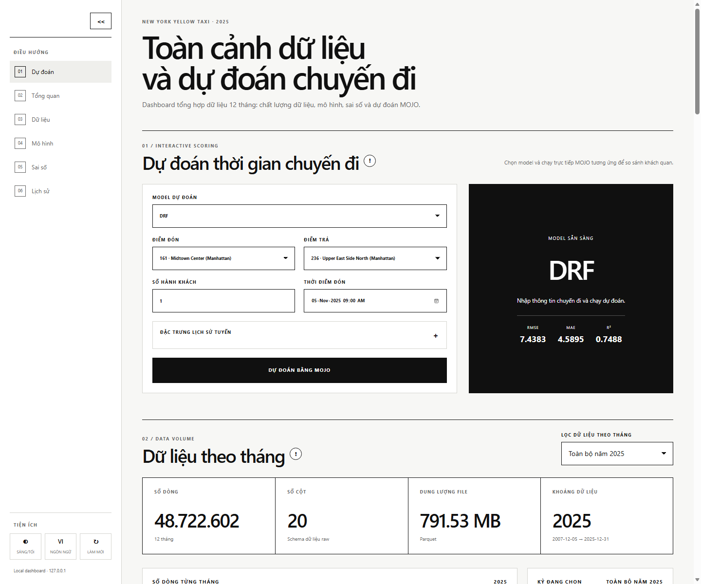

# NYC Taxi Sparkling Water

Phân tích dữ liệu lớn và dự đoán thời gian chuyến đi Yellow Taxi tại New York
bằng Apache Spark, H2O Sparkling Water, PostgreSQL, MOJO, Structured Streaming,
Docker và Kubernetes.

Repository này chứa mã nguồn, cấu hình, metrics, biểu đồ và ứng dụng demo của
đồ án. Dữ liệu taxi 12 tháng, đầu ra dự đoán dung lượng lớn và một số MOJO vượt
giới hạn GitHub không được lưu trực tiếp trong Git; các phần này được tái tạo
bằng pipeline và script được mô tả bên dưới.



## 1. Trạng thái hiện tại

Cập nhật bằng chứng gần nhất: **15/10/2026**.

| Hạng mục | Trạng thái | Bằng chứng |
|---|---|---|
| Dữ liệu Yellow Taxi 12 tháng năm 2025 | Hoàn tất | 48.722.602 dòng raw |
| Làm sạch và feature engineering bằng Spark | Hoàn tất | 46.714.819 dòng sạch |
| Taxi Zone CSV và PostgreSQL JDBC | Hoàn tất | `jdbc_status=CONNECTED` |
| Chronological split | Hoàn tất | Train tháng 1–9, validation tháng 10, test tháng 11–12 |
| GBM, DRF, Deep Learning | Hoàn tất | Metrics theo thời gian |
| GBM Grid Search và AutoML | Hoàn tất | Kết quả so sánh 5 phương pháp |
| Error analysis và Feature Importance | Hoàn tất | CSV, PNG và dashboard |
| MOJO batch scoring | Hoàn tất | 8.155.303 dòng test, 0 prediction null |
| Structured Streaming | Hoàn tất | 10 micro-batch, 1.000 dòng, 0 prediction null |
| H2O Flow demo quy mô vừa | Hoàn tất | 200.000 train, 50.000 test, 50.000 prediction |
| Dashboard local | Hoàn tất | API và dự đoán thực bằng 5 MOJO local |
| Docker runtime | Chưa xác nhận lần cuối | Dockerfile và script có sẵn; daemon/dung lượng hệ thống còn là điều kiện |
| Kubernetes runtime | Chưa xác nhận lần cuối | Manifest có sẵn; cần Job đạt trạng thái `Complete` |

Kết quả kiểm tra bốn tiêu chí kỹ thuật được lưu tại
[`outputs/metrics/technical_validation.json`](outputs/metrics/technical_validation.json).
File này không chấm phần báo cáo, slide hoặc phối hợp nhóm.

## 2. Bài toán và giá trị ứng dụng

Đầu vào của sản phẩm gồm:

- Taxi Zone điểm đón và điểm trả.
- Số hành khách.
- Thời điểm đón.
- Thống kê lịch sử của tuyến.

Đầu ra là `trip_duration_minutes`: thời gian chuyến đi dự đoán theo phút.

Kết quả có thể minh họa cho:

- Ước lượng thời gian đến nơi cho hành khách hoặc tổng đài taxi.
- So sánh các mô hình hồi quy trên cùng chronological test.
- Xác định khung giờ, quận, tuyến hoặc nhóm thời lượng có sai số cao.
- Chấm điểm hàng loạt bằng MOJO mà không khởi động lại quá trình huấn luyện.
- Mô phỏng chấm điểm dữ liệu mới bằng Structured Streaming.

Đây là sản phẩm học thuật. Dashboard không sử dụng traffic, thời tiết hoặc sự
kiện theo thời gian thực, vì vậy không nên mô tả kết quả như ETA production.

## 3. Kiến trúc

```text
NYC TLC Yellow Taxi Parquet (2025-01 ... 2025-12)
Taxi Zone Lookup CSV
PostgreSQL zone_statistics
                 |
                 v
        Apache Spark / DataFrame
    download -> cleaning -> feature engineering
       -> JDBC join -> chronological split
                 |
                 v
           H2O Sparkling Water
 GBM | DRF | Deep Learning | Grid Search | AutoML
                 |
                 v
      evaluation + error analysis + charts
                 |
                 v
               MOJO
      batch | streaming | dashboard
      Docker image | Kubernetes Job
```

### Luồng dữ liệu

1. Tải và xác thực 12 file Parquet của NYC TLC.
2. Đọc dữ liệu bằng Spark DataFrame.
3. Chuẩn hóa schema, xử lý null, trùng lặp và giá trị không hợp lệ.
4. Tạo đặc trưng thời gian, tuyến và Taxi Zone.
5. Kết hợp dữ liệu Taxi Zone CSV và PostgreSQL qua JDBC.
6. Chia dữ liệu theo thời gian.
7. Huấn luyện và đánh giá năm phương pháp H2O.
8. Chọn DRF làm model triển khai dựa trên kết quả test hiện tại.
9. Export MOJO để batch scoring, streaming và demo dashboard.

## 4. Công nghệ

| Công nghệ | Phiên bản trong môi trường đã kiểm chứng |
|---|---|
| Python | 3.11 |
| Java | 17 cho Spark; launcher H2O Flow ưu tiên Java 8 nếu có |
| Apache Spark / PySpark | 3.5.0 |
| H2O | 3.46.0.6 |
| Sparkling Water | 3.46.0.6-1-3.5 |
| PostgreSQL | Môi trường local dùng PostgreSQL 18 |
| Docker Desktop | Dùng cho image scoring |
| Kubernetes | Docker Desktop Kubernetes |

Các package Python được khóa trong
[`requirements.txt`](requirements.txt).

## 5. Dữ liệu

Nguồn dữ liệu chính là **NYC TLC Yellow Taxi Trip Records năm 2025**.

| Chỉ số | Giá trị |
|---|---:|
| Số tháng | 12 |
| Số dòng raw | 48.722.602 |
| Số cột raw | 20 |
| Tổng dung lượng raw ghi nhận | 791,53 MB |
| Số dòng sạch | 46.714.819 |
| Số dòng bị loại | 2.007.783 |
| Tỷ lệ bị loại | 4,1208% |

Một số file raw chứa timestamp bất thường ngoài năm 2025. Đây là lý do phần
raw summary có thể xuất hiện ngày 2007 hoặc 2009. Pipeline làm sạch chỉ giữ dữ
liệu hợp lệ trong phạm vi nghiên cứu.

### Quy tắc làm sạch đã ghi nhận

| Loại | Số dòng |
|---|---:|
| Duplicate | 721.678 |
| Thời lượng không hợp lệ | 1.109.695 |
| Số hành khách không hợp lệ | 260.208 |
| Null pickup | 0 |
| Null drop-off | 0 |

Nguồn metrics:

```text
outputs/metrics/raw_dataset_summary.csv
outputs/metrics/cleaning_summary.csv
```

## 6. Phân chia dữ liệu

Không dùng `randomSplit` cho kết quả cuối kỳ. Dữ liệu được chia theo thời gian:

| Split | Khoảng thời gian | Số dòng | Tỷ lệ |
|---|---|---:|---:|
| Train | 01/01/2025 – 30/09/2025 | 34.327.814 | 73,4838% |
| Validation | 01/10/2025 – 31/10/2025 | 4.231.702 | 9,0586% |
| Test | 01/11/2025 – 31/12/2025 | 8.155.303 | 17,4576% |

Thống kê tuyến dùng cho validation và test được xây dựng từ giai đoạn train,
không lấy trực tiếp thông tin tương lai của validation/test. Tuy nhiên, thống kê
bên trong chính tập train là tổng hợp trên toàn khoảng train, chưa phải
expanding-window nghiêm ngặt cho từng thời điểm.

## 7. Đặc trưng mô hình

| Feature | Ý nghĩa |
|---|---|
| `pickup_location` | Mã Taxi Zone điểm đón |
| `dropoff_location` | Mã Taxi Zone điểm trả |
| `passenger_count` | Số hành khách |
| `pickup_hour` | Giờ đón, từ 0 đến 23 |
| `pickup_day_of_week` | Thứ trong tuần |
| `pickup_month` | Tháng đón |
| `is_weekend` | Cờ cuối tuần |
| `route_trip_count` | Số chuyến lịch sử trên cùng tuyến |
| `route_avg_duration` | Thời gian trung bình lịch sử của tuyến |
| `hour_route_avg_duration` | Thời gian trung bình lịch sử của tuyến tại giờ đón |

Response:

```text
trip_duration_minutes
```

Từ điển đầy đủ nằm tại
[`outputs/metrics/feature_dictionary.csv`](outputs/metrics/feature_dictionary.csv).

## 8. Kết quả mô hình

Metrics hiện tại được lấy từ chronological test sample:

| Model | RMSE | MAE | R² | Test sample |
|---|---:|---:|---:|---:|
| DRF | 7,4383 | 4,5895 | 0,7488 | 400.000 |
| GBM Grid Search | 7,4631 | 4,6329 | 0,7472 | 400.000 |
| GBM | 7,4664 | 4,6192 | 0,7469 | 400.000 |
| AutoML | 7,4781 | 4,6491 | 0,7479 | 200.000 |
| Deep Learning | 7,5343 | 4,7840 | 0,7423 | 400.000 |

DRF có RMSE và MAE thấp nhất trong kết quả hiện tại nên được chọn làm model
triển khai cuối cùng.

### Cách đọc chỉ số

- `RMSE`: phạt mạnh các sai số lớn; thấp hơn tốt hơn.
- `MAE`: sai số tuyệt đối trung bình theo phút; thấp hơn tốt hơn.
- `R²`: tỷ lệ biến thiên được giải thích; gần 1 hơn tốt hơn.

Việc huấn luyện model local dùng mẫu cố định để phù hợp RAM:

- GBM, DRF, Deep Learning và Grid Search:
  1.200.000 train / 400.000 validation / 400.000 test.
- AutoML:
  600.000 train / 200.000 validation / 200.000 test.
- Spark ETL vẫn xử lý toàn bộ dữ liệu.
- MOJO cuối cùng chấm toàn bộ 8.155.303 dòng test.

Metrics nguồn:

```text
outputs/metrics/model_comparison.csv
outputs/metrics/model_comparison.json
outputs/metrics/final_model_metrics.json
```

## 9. Kết quả MOJO và Streaming

### MOJO batch scoring

| Chỉ số | Giá trị |
|---|---:|
| Dòng test được chấm | 8.155.303 |
| Dùng toàn bộ test | Có |
| Prediction null | 0 |
| Prediction trung bình | 17,9458 phút |
| Thời gian ghi nhận | 338,86 giây |
| Throughput ghi nhận | 24.066,78 dòng/giây |

### Structured Streaming

| Chỉ số | Giá trị |
|---|---:|
| Micro-batch | 10 |
| Tổng dòng | 1.000 |
| Prediction null | 0 |
| Throughput ghi nhận | 91,58 dòng/giây |

Kết quả nằm tại:

```text
outputs/metrics/mojo_scoring_summary.json
outputs/metrics/streaming_summary.json
```

## 10. Cấu trúc repository

```text
NYC-Taxi-Sparkling-Water/
├── config/
│   ├── database.env.example
│   ├── project_config.yaml
│   └── spark-defaults.conf
├── database/
│   └── init.sql
├── docker/
│   └── Dockerfile
├── docs/
├── kubernetes/
│   ├── final-job.yaml
│   └── mojo-job.yaml
├── models/
│   ├── README.md
│   ├── deep_learning_mojo/
│   ├── gbm_grid_best_mojo/
│   └── nyc_taxi_gbm_mojo/
├── outputs/
│   ├── charts/
│   ├── metrics/
│   └── screenshots/
├── scripts/
├── src/
│   ├── app/               # Dashboard và API MOJO
│   ├── common/
│   ├── data/
│   ├── demo/
│   ├── evaluation/
│   ├── h2o/
│   ├── models/
│   ├── prediction/
│   ├── streaming/
│   └── tests/
├── .gitignore
├── FINAL_PROJECT_PROGRESS.md
├── README.md
└── requirements.txt
```

Các thư mục dữ liệu, log, predictions và model lớn được `.gitignore` loại khỏi
Git thông thường.

## 11. Yêu cầu môi trường

Hướng dẫn dưới đây ưu tiên Windows vì các launcher `.cmd` và đường dẫn hiện tại
đã được kiểm chứng trên Windows.

### Phần mềm cần có

- Git.
- Python 3.11.
- Java 17 64-bit.
- Apache Spark 3.5.0 Hadoop 3.
- PostgreSQL.
- Docker Desktop và Kubernetes nếu muốn chạy phần deployment.
- Java 8 64-bit hoặc biến `H2O_JAVA_HOME` nếu Java 17 gây lỗi với H2O
  standalone trên máy cụ thể.

### Đường dẫn mặc định

[`scripts/activate_project.cmd`](scripts/activate_project.cmd) đang dùng:

```text
JAVA_HOME=D:\BigData\Tools\Java\jdk-17
SPARK_HOME=D:\BigData\Tools\Spark\spark-3.5.0-bin-hadoop3
HADOOP_HOME=D:\BigData\Tools\Spark\spark-3.5.0-bin-hadoop3\hadoop
```

Nếu cài công cụ ở vị trí khác, sửa ba biến trên trước khi chạy.

Script cũng thiết lập:

```text
PYTHONUTF8=1
PYTHONIOENCODING=utf-8
```

để tránh lỗi font và lỗi `UnicodeEncodeError` trên terminal Windows.

## 12. Cài đặt từ đầu

### Bước 1: Clone repository

```bat
cd /d D:\BigData
git clone https://github.com/danhhuit/NYC-Taxi-Sparkling-Water.git
cd /d D:\BigData\NYC-Taxi-Sparkling-Water
```

### Bước 2: Tạo virtual environment

```bat
py -3.11 -m venv .venv
.venv\Scripts\activate.bat
python -m pip install --upgrade pip
pip install -r requirements.txt
```

### Bước 3: Kiểm tra cấu hình Spark và Java

```bat
scripts\activate_project.cmd
python --version
java -version
spark-submit --version
```

### Bước 4: Chuẩn bị PostgreSQL

Tạo database:

```sql
CREATE DATABASE nyc_taxi_db;
```

Sau đó chạy:

```bat
psql -U postgres -d nyc_taxi_db -f database\init.sql
```

Đặt mật khẩu trong đúng terminal dùng để chạy pipeline:

```bat
set "NYC_TAXI_DB_PASSWORD=your_password"
```

PowerShell:

```powershell
$env:NYC_TAXI_DB_PASSWORD = "your_password"
```

Không ghi mật khẩu thật vào Git. `config/database.env` đã được ignore.

### Bước 5: Kiểm tra môi trường

```powershell
powershell -NoProfile -ExecutionPolicy Bypass -File scripts\check_environment.ps1
```

Docker hoặc Kubernetes có thể báo lỗi nếu chưa bật; lỗi này không ngăn phần
Spark/H2O/Dashboard chạy.

## 13. Model lớn và dữ liệu không có trong Git

GitHub chặn file đơn lớn hơn 100 MB. Ba artifact local sau không được commit:

| Artifact | Kích thước xấp xỉ |
|---|---:|
| `models/final_mojo/mojo_model` | 140 MB |
| `models/drf_mojo/mojo_model` | 140 MB |
| `models/automl_best_mojo/mojo_model` | 174 MB |

Tái tạo DRF cuối:

```bat
scripts\activate_project.cmd
python -m src.models.train_final_additional_models --models drf --promote-drf
```

Tái tạo AutoML:

```bat
python -m src.models.automl
```

Dữ liệu raw và processed cũng không nằm trong Git. Có thể tải và xử lý lại bằng
pipeline 12 tháng ở phần tiếp theo.

Nếu chỉ xem giao diện mà chưa có đủ model local, dashboard vẫn khởi động nhưng
chỉ liệt kê các MOJO thực sự tồn tại.

## 14. Chạy toàn bộ pipeline 12 tháng

Mở Command Prompt:

```bat
cd /d D:\BigData\NYC-Taxi-Sparkling-Water
set "NYC_TAXI_DB_PASSWORD=your_password"
scripts\run_12_month_pipeline.cmd
```

Pipeline chạy tuần tự:

1. Download và xác thực 12 tháng.
2. Cleaning, feature engineering, JDBC join và chronological split.
3. Huấn luyện GBM.
4. Huấn luyện DRF và Deep Learning; promote DRF.
5. GBM Grid Search.
6. AutoML.
7. Model comparison và biểu đồ.
8. Feature Importance.
9. Error Analysis.
10. MOJO scoring trên toàn bộ test.
11. Structured Streaming.
12. Integrated Demo.

Chỉ download:

```bat
scripts\run_12_month_pipeline.cmd --download-only
```

Chạy lại phần cuối khi dữ liệu processed đã tồn tại:

```bat
scripts\run_remaining_pipeline.cmd
```

Không nên chạy Grid Search hoặc AutoML trên toàn bộ 46,7 triệu dòng ở máy local
16 GB RAM. Các giới hạn mặc định là chủ đích để pipeline hoàn thành ổn định và
so sánh các model trên sample tái lập.

## 15. Chạy từng tác vụ từ Terminal

Kích hoạt môi trường trước:

```bat
cd /d D:\BigData\NYC-Taxi-Sparkling-Water
scripts\activate_project.cmd
set "NYC_TAXI_DB_PASSWORD=your_password"
```

### Dữ liệu

```bat
python -m src.data.download_multimonth
python -m src.data.final_data_pipeline
```

### Huấn luyện

```bat
python -m src.models.train_final_gbm
python -m src.models.train_final_additional_models --promote-drf
python -m src.models.gbm_grid_search
python -m src.models.automl
```

### Đánh giá

```bat
python -m src.evaluation.compare_models
python -m src.evaluation.visualize_metrics
python -m src.evaluation.feature_importance
python -m src.evaluation.final_error_analysis
```

### MOJO batch scoring

Chấm toàn bộ test:

```bat
python -m src.prediction.final_mojo_score --rows 0
```

Chạy thử 100.000 dòng:

```bat
python -m src.prediction.final_mojo_score --rows 100000
```

`--rows 0` nghĩa là không giới hạn số dòng.

### Structured Streaming

```bat
python -m src.streaming.final_streaming
```

Tùy chỉnh:

```bat
python -m src.streaming.final_streaming --batches 10 --rows-per-batch 100
```

## 16. Demo Terminal

Đây là luồng demo không cần chạy lại toàn bộ quá trình huấn luyện.

### Bước 1: Kích hoạt môi trường

```bat
cd /d D:\BigData\NYC-Taxi-Sparkling-Water
scripts\activate_project.cmd
```

### Bước 2: Kiểm tra dashboard và 5 MOJO local

```bat
scripts\test_dashboard.cmd
```

Kết quả mong đợi:

```text
"status": "PASS"
"drf": {"status": "PASS"}
"gbm_grid": {"status": "PASS"}
"gbm": {"status": "PASS"}
"automl": {"status": "PASS"}
"deep_learning": {"status": "PASS"}
```

Nếu model lớn chưa được tải hoặc tái tạo, self-test sẽ chỉ hoàn tất khi các
artifact tương ứng tồn tại.

### Bước 3: Chạy kiểm tra bốn tiêu chí kỹ thuật

```bat
scripts\validate_technical_deliverables.cmd
```

Kết quả mong đợi:

```text
"status": "PASS"
"application": true
"data_processing": true
"modeling": true
"visualization_application": true
```

### Bước 4: Chạy integrated demo

```bat
scripts\run_final_demo.cmd
```

Dòng kết thúc:

```text
FINAL INTEGRATED DEMO SUCCESS
```

### Bước 5: Demo bằng spark-submit

```bat
scripts\run_spark_submit.cmd
```

Log:

```text
outputs/logs/spark_submit.log
```

### Nội dung nên trình bày

1. Quy mô 12 tháng và số dòng sạch.
2. Chronological split.
3. Năm mô hình và bảng RMSE/MAE/R².
4. DRF là model triển khai hiện tại.
5. MOJO chấm toàn bộ test.
6. Structured Streaming.
7. H2O Flow và Dashboard.
8. Trạng thái thực tế của Docker/Kubernetes.

## 17. H2O Flow: chỉ khởi động local

Chế độ này chỉ mở H2O Flow, không import dữ liệu lớn và không train lại model.

```bat
cd /d D:\BigData\NYC-Taxi-Sparkling-Water
scripts\stop_h2o_flow.cmd
scripts\start_h2o_flow.cmd
```

Chờ terminal hiển thị:

```text
H2O READY
Cloud name : nyc_taxi_external
Cloud size : 1
Flow URL   : http://127.0.0.1:54321
```

Nếu trình duyệt không tự mở:

```text
http://127.0.0.1:54321
```

Trong Flow:

1. Kiểm tra góc dưới bên trái là `Ready`.
2. Chọn **Admin → Cluster Status**.
3. Xác nhận cloud name `nyc_taxi_external`.
4. Xác nhận cloud healthy và cloud size bằng 1.

Dừng H2O:

```bat
scripts\stop_h2o_flow.cmd
```

## 18. H2O Flow: demo quy mô vừa

Đây là chế độ được khuyến nghị cho buổi bảo vệ:

```text
Train: 200.000 dòng
Test :  50.000 dòng
Heap : 2 GB
```

### Bước 1: Chuẩn bị dữ liệu

```bat
scripts\prepare_h2o_flow_demo.cmd
```

Tạo lại:

```bat
scripts\prepare_h2o_flow_demo.cmd --force
```

Kết quả:

```text
data/flow/local_demo/h2o_train_demo_200000.parquet
data/flow/local_demo/h2o_test_demo_50000.parquet
data/flow/local_demo/manifest.json
```

### Bước 2: Khởi động H2O

```bat
scripts\start_h2o_flow_demo.cmd
```

### Bước 3A: Nạp frame tự động

```bat
scripts\load_h2o_flow_demo.cmd
```

Kết quả mong đợi:

```text
train_frame = nyc_taxi_demo_train_200k
train_rows  = 200000
test_frame  = nyc_taxi_demo_test_50k
test_rows   = 50000
```

### Bước 3B: Nạp thủ công trên GUI

Trong H2O Flow chọn **Data → Import Files**.

Train:

```text
D:/BigData/NYC-Taxi-Sparkling-Water/data/flow/local_demo/h2o_train_demo_200000.parquet
```

Tại **Parse Setup**:

```text
Destination Frame = nyc_taxi_demo_train_200k
Parser Type       = AUTO/PARQUET
```

Nhấn **Parse**, sau đó kiểm tra `200000` dòng.

Test:

```text
D:/BigData/NYC-Taxi-Sparkling-Water/data/flow/local_demo/h2o_test_demo_50000.parquet
```

Đặt:

```text
Destination Frame = nyc_taxi_demo_test_50k
Parser Type       = AUTO/PARQUET
```

Kiểm tra `50000` dòng.

Không chọn file `.crc` hoặc `_SUCCESS`. Hai file demo là Parquet đơn nên không
cần chọn hàng nghìn file part.

### Bước 4: Train DRF trên H2O Flow

Chọn **Model → Build Model → Distributed Random Forest**.

Cấu hình:

```text
model_id         = nyc_taxi_flow_demo_drf
training_frame   = nyc_taxi_demo_train_200k
validation_frame = nyc_taxi_demo_test_50k
response_column  = trip_duration_minutes
ntrees           = 30
max_depth        = 12
min_rows         = 20
sample_rate      = 0.8
mtries           = -1
seed             = 42
```

Lưu ý:

- `trip_duration_minutes` là response, không phải feature.
- Bài toán phải được nhận diện là Regression.
- Khi báo cáo chất lượng, dùng **Validation Metrics**, không dùng Training
  Metrics.

### Bước 5: Xem kết quả

Mở:

```text
Model → List All Models → nyc_taxi_flow_demo_drf
```

Kết quả demo đã kiểm chứng:

| Chỉ số | Giá trị |
|---|---:|
| Validation rows | 50.000 |
| RMSE | 7,5550 |
| MAE | 4,6500 |
| R² | 0,7438 |

Model Flow demo khác model cuối vì chỉ train trên 200.000 dòng. Không dùng
metrics Flow demo để thay thế bảng kết quả chính thức.

### Bước 6: Predict trên Flow

1. Mở model `nyc_taxi_flow_demo_drf`.
2. Chọn **Predict**.
3. Chọn frame `nyc_taxi_demo_test_50k`.
4. Đặt destination nếu Flow cho phép:

   ```text
   nyc_taxi_flow_demo_predictions_50k
   ```

5. Chạy và mở prediction frame.
6. Xác nhận 50.000 dòng và cột `predict`.

### Tự động đối chiếu toàn bộ model Flow

```bat
scripts\run_h2o_flow_demo_model.cmd --force
```

Metrics được ghi tại:

```text
outputs/metrics/h2o_flow_demo_metrics.json
```

### Bằng chứng nên chụp

- Cluster Status.
- Train frame 200.000 dòng.
- Test frame 50.000 dòng.
- Cấu hình DRF.
- Validation RMSE, MAE, R².
- Variable Importance.
- Prediction frame 50.000 dòng.

## 19. Sparkling Water external backend

Giữ H2O `nyc_taxi_external` đang chạy rồi mở terminal khác:

```bat
scripts\run_h2o_external_backend_check.cmd
```

Kết quả mong đợi:

```text
EXTERNAL H2O CONTEXT CONNECTED SUCCESSFULLY
SPARK ROW COUNT: 10
H2O -> SPARK ROW COUNT: 10
EXTERNAL BACKEND TEST SUCCESS
EXTERNAL BACKEND VALIDATION PASSED
```

Sau đó trong H2O Flow chọn **Data → List All Frames** và mở
`external_backend_demo`.

## 20. H2O Flow full 12 tháng

Chế độ full-data là tùy chọn, không phải luồng demo local mặc định.

Yêu cầu:

- Khoảng 8 GB heap H2O.
- Ít nhất 10 GB RAM trống gồm heap và dự phòng hệ điều hành.
- Nên tắt Docker Desktop, Kubernetes và Spark job khác.

Kiểm tra tài nguyên:

```powershell
powershell -NoProfile -ExecutionPolicy Bypass -File scripts\test_h2o_flow_resources.ps1 -HeapGb 8
```

Khởi động:

```bat
set "H2O_HEAP_GB=8"
scripts\start_h2o_flow_full.cmd
```

Thư mục import:

```text
D:/BigData/NYC-Taxi-Sparkling-Water/data/flow/full_12_months
```

Không cố import toàn bộ dữ liệu khi RAM không đủ. Bằng chứng xử lý full-data
chính của đề tài nằm ở Spark ETL và MOJO scoring, không phụ thuộc H2O Flow GUI.

## 21. Dashboard local

Dashboard dùng Python standard library, không cần Flask hoặc Streamlit.

### Khởi động

```bat
cd /d D:\BigData\NYC-Taxi-Sparkling-Water
scripts\run_dashboard.cmd
```

Truy cập:

```text
http://127.0.0.1:8501
```

Nếu cổng 8501 đang được sử dụng, đóng terminal dashboard cũ bằng `Ctrl+C` rồi
chạy lại.

### Các chức năng

- Dự đoán thời gian chuyến đi bằng MOJO thật.
- Chuyển giữa DRF, GBM Grid Search, GBM, AutoML và Deep Learning nếu artifact
  tương ứng tồn tại.
- Hiển thị RMSE, MAE và R² của model đang chọn.
- Lọc dữ liệu theo từng tháng hoặc toàn bộ năm.
- Cập nhật số dòng, số cột, dung lượng và khoảng thời gian theo tháng.
- Lọc bảng/biểu đồ so sánh theo model.
- Chọn `Tất cả`, `RMSE`, `MAE` hoặc `R²`.
- Biểu đồ động, tooltip và nhãn số trên cột.
- Feature Importance và phân tích sai số theo nhiều chiều.
- Nút `!` giải thích ngắn gọn các chỉ số và feature.
- Light/dark mode và Việt/Anh.
- Sidebar có thể thu gọn.
- Lịch sử hoạt động lưu trong `localStorage`.
- Phân trang lịch sử và xuất toàn bộ lịch sử thành JSON.

### Demo dự đoán

1. Mở mục **Dự đoán thời gian chuyến đi**.
2. Chọn model.
3. Chọn Taxi Zone điểm đón và điểm trả.
4. Nhập số hành khách và thời điểm đón.
5. Mở **Đặc trưng lịch sử tuyến** nếu muốn thay đổi:

   ```text
   route_trip_count
   route_avg_duration
   hour_route_avg_duration
   ```

6. Nhấn **Dự đoán bằng MOJO**.
7. Trình bày:
   - Model thực sự đã chạy.
   - Số phút dự đoán.
   - RMSE, MAE và R² của model.
8. Giữ nguyên đầu vào, đổi model và dự đoán lại để so sánh khách quan.

Ba feature lịch sử trong form là đầu vào học thuật lấy từ pipeline hoặc nhập
minh họa; chúng không phải dữ liệu giao thông trực tiếp.

### Demo Data volume

1. Chọn một tháng trong bộ lọc.
2. Quan sát bốn KPI thay đổi.
3. Kiểm tra biểu đồ số dòng theo tháng.
4. Kiểm tra bảng chỉ còn dòng của tháng đã chọn.
5. Nhấn `!` để giải thích ý nghĩa KPI.

### Demo Model comparison

1. Chọn `Tất cả`: ba biểu đồ RMSE, MAE và R² xếp dọc.
2. Chọn riêng RMSE, MAE hoặc R².
3. Hover vào cột để xem đúng chỉ số đang chọn.
4. Lọc một model để đối chiếu với bảng.
5. Mở `!` tại Feature Importance để giải thích mười feature.

### API

| Endpoint | Chức năng |
|---|---|
| `GET /api/health` | Kiểm tra artifact |
| `GET /api/summary` | Dataset, split, model comparison |
| `GET /api/analytics` | Monthly data, cleaning, feature importance, errors |
| `GET /api/models` | Các MOJO khả dụng và metrics |
| `GET /api/zones` | Danh sách Taxi Zone |
| `POST /api/predict` | Dự đoán bằng model được chọn |

Ví dụ PowerShell:

```powershell
$body = @{
    model = "drf"
    pickup_location = 161
    dropoff_location = 236
    passenger_count = 1
    pickup_datetime = "2025-11-05T09:00"
    route_trip_count = 10000
    route_avg_duration = 15
    hour_route_avg_duration = 15
} | ConvertTo-Json

Invoke-RestMethod `
    -Uri "http://127.0.0.1:8501/api/predict" `
    -Method Post `
    -ContentType "application/json" `
    -Body $body
```

Model keys:

```text
drf
gbm_grid
gbm
automl
deep_learning
```

## 22. Docker

### Trạng thái khách quan

Dockerfile và script validation đã tồn tại. Lần kiểm tra gần nhất chưa có bằng
chứng runtime cuối cùng vì Docker daemon/dung lượng ổ hệ thống chưa đáp ứng.
Không xem việc có Dockerfile là bằng chứng container đã chạy thành công.

### Điều kiện

- Docker Desktop đang ở trạng thái Engine running.
- Ổ hệ thống còn ít nhất 10 GB.
- `models/final_mojo` tồn tại.
- `data/processed/batch_input.parquet` tồn tại.

### Chạy tự động cùng Kubernetes

```bat
scripts\validate_deployment_after_reboot.cmd
```

### Chạy Docker thủ công

```bat
docker build -f docker\Dockerfile -t nyc-taxi-final:1.0 .
docker run --rm --name nyc-taxi-final-demo nyc-taxi-final:1.0
```

Chỉ công bố Docker hoàn tất khi container exit code bằng 0 và log có:

```text
DOCKER FINAL VALIDATION SUCCESS
```

Log:

```text
outputs/logs/docker_final.log
```

## 23. Kubernetes

### Điều kiện

1. Docker Desktop đang chạy.
2. Kubernetes đã bật và node ở trạng thái `Ready`.
3. Image `nyc-taxi-final:1.0` đã build.
4. Image đã được nạp vào containerd của Docker Desktop Kubernetes.

Kiểm tra:

```bat
kubectl config current-context
kubectl get nodes
```

Luồng khuyến nghị:

```bat
scripts\validate_deployment_after_reboot.cmd
```

Script sẽ:

1. Build Docker image.
2. Chạy container scoring.
3. Kiểm tra Kubernetes.
4. Nạp image vào Kubernetes containerd.
5. Xóa Job cũ.
6. Apply `kubernetes/final-job.yaml`.
7. Chờ tối đa 30 phút.
8. Lưu log và trạng thái.

Kiểm tra thủ công sau khi apply:

```bat
kubectl get jobs
kubectl get pods -l app=nyc-taxi-final
kubectl logs job/nyc-taxi-final-job --all-containers=true
```

Chỉ công bố Kubernetes hoàn tất khi:

```text
Job Complete
KUBERNETES FINAL VALIDATION SUCCESS
```

Log:

```text
outputs/logs/kubernetes_final.log
```

## 24. Kịch bản demo hoàn chỉnh

### Phương án 10–15 phút

1. **Giới thiệu bài toán** — 1 phút

   Nêu đầu vào, đầu ra và giá trị ứng dụng.

2. **Terminal** — 2 phút

   Chạy `scripts\test_dashboard.cmd` và
   `scripts\validate_technical_deliverables.cmd`.

3. **Dữ liệu và model** — 2 phút

   Trình bày 48,7 triệu dòng raw, 46,7 triệu dòng sạch, chronological split và
   bảng 5 model.

4. **H2O Flow** — 3 phút

   Mở cluster, train/predict DRF demo 200k/50k hoặc mở model/frame đã chuẩn bị.

5. **Dashboard** — 4 phút

   Lọc tháng, xem charts, đổi model, chạy dự đoán, giải thích Feature
   Importance và error analysis.

6. **MOJO/Streaming/Deployment** — 2 phút

   Trình bày batch 8.155.303 dòng, streaming 10 batch và trạng thái khách quan
   của Docker/Kubernetes.

7. **Kết luận** — 1 phút

   Nêu DRF là model hiện tại và các giới hạn kỹ thuật.

### Không nên làm trong buổi demo

- Train lại toàn bộ 12 tháng.
- Import 46,7 triệu dòng vào Flow trên máy thiếu RAM.
- Chạy Grid Search hoặc AutoML full-data.
- Tuyên bố Docker/Kubernetes runtime thành công khi chưa có log.
- Mô tả các feature lịch sử nhập tay là traffic real-time.

## 25. Kiểm thử

### Unit test dashboard

```bat
.venv\Scripts\python.exe -m unittest src.tests.test_dashboard -v
```

Kết quả hiện tại:

```text
Ran 7 tests
OK
```

### Self-test MOJO

```bat
scripts\test_dashboard.cmd
```

### Technical validation

```bat
scripts\validate_technical_deliverables.cmd
```

### Compile Python

```bat
.venv\Scripts\python.exe -m compileall -q src
```

## 26. Output quan trọng

```text
outputs/metrics/raw_dataset_summary.csv
outputs/metrics/cleaning_summary.csv
outputs/metrics/split_summary.csv
outputs/metrics/multisource_join_summary.csv
outputs/metrics/model_comparison.csv
outputs/metrics/model_comparison.json
outputs/metrics/feature_dictionary.csv
outputs/metrics/feature_importance.csv
outputs/metrics/mojo_scoring_summary.json
outputs/metrics/streaming_summary.json
outputs/metrics/h2o_flow_demo_metrics.json
outputs/metrics/technical_validation.json

outputs/charts/rmse_comparison.png
outputs/charts/mae_comparison.png
outputs/charts/r2_comparison.png
outputs/charts/feature_importance.png
outputs/charts/error_by_hour.png
outputs/charts/error_by_day_of_week.png
outputs/charts/error_by_borough.png
outputs/charts/error_by_dropoff_borough.png
outputs/charts/error_by_duration_range.png

outputs/screenshots/dashboard.png
outputs/screenshots/dashboard_dark.png
```

## 27. Xử lý lỗi thường gặp

### H2O không nghe cổng 54321

```bat
scripts\stop_h2o_flow.cmd
scripts\start_h2o_flow.cmd
```

Kiểm tra:

```bat
netstat -ano | findstr :54321
```

### `GC overhead limit exceeded` trên H2O Flow

Nguyên nhân thường là import quá nhiều Parquet vào heap nhỏ.

Giải pháp:

- Dùng demo 200.000 train + 50.000 test.
- Không import `batch_input.parquet` như dữ liệu 12 tháng.
- Không chọn `.crc` hoặc `_SUCCESS`.
- Dừng các tiến trình Spark/Docker nặng.
- Chỉ dùng full-data mode khi đủ RAM.

### Dashboard báo port 8501 đang được dùng

Đóng dashboard cũ bằng `Ctrl+C`, sau đó:

```bat
scripts\run_dashboard.cmd
```

### Dashboard không thấy đủ 5 model

Kiểm tra:

```text
models/final_mojo/mojo_model
models/gbm_grid_best_mojo/mojo_model
models/nyc_taxi_gbm_mojo/mojo_model
models/automl_best_mojo/mojo_model
models/deep_learning_mojo/mojo_model
```

Model lớn không có trong Git phải được tái tạo hoặc cung cấp riêng.

### Lỗi font hoặc `UnicodeEncodeError`

Chạy:

```bat
scripts\activate_project.cmd
```

Script thiết lập Python UTF-8. Không dùng terminal cũ chưa nạp lại biến môi
trường.

### Docker daemon unavailable

- Mở Docker Desktop.
- Chờ Engine running.
- Kiểm tra `docker version`.
- Khởi động lại Windows nếu Docker Desktop báo lỗi engine socket.

### Docker thiếu dung lượng

Script yêu cầu tối thiểu 10 GB trống trên ổ hệ thống. Giải phóng dung lượng hoặc
chuyển Docker disk image trước khi chạy lại.

## 28. Phân công nhóm

Mức đóng góp dự kiến: **50% mỗi thành viên**.

| Thành viên | Công việc |
|---|---|
| Nguyễn Thành Danh | Dữ liệu 12 tháng; Spark cleaning và feature engineering; PostgreSQL/JDBC; chronological split; GBM/DRF; MOJO batch và Streaming; phần báo cáo dữ liệu–kiến trúc |
| Nguyễn Quốc An | Deep Learning, Grid Search và AutoML; model comparison; error analysis; dashboard; H2O Flow; Docker/Kubernetes; phần báo cáo mô hình–kết quả |
| Cả hai | Kiểm thử tích hợp, README, slide, demo, phản biện và kiểm tra sản phẩm trước khi nộp |

Để chứng minh phối hợp nhóm, báo cáo nên bổ sung bảng theo tuần gồm: thời gian,
công việc, người phụ trách, kết quả và bằng chứng.

## 29. Đối chiếu rubric

| Tiêu chí | Trạng thái bằng chứng hiện tại |
|---|---|
| Tính ứng dụng của kỹ thuật | Đạt |
| Lưu trữ và xử lý/phân tích dữ liệu | Đạt |
| Mô hình/công nghệ xử lý | Đạt |
| Trực quan hóa/xây dựng ứng dụng | Đạt |
| Trình bày báo cáo | Phải nộp riêng Word và PowerPoint |
| Phân công/phối hợp nhóm | Có phân công; cần nhật ký tuần và bằng chứng đóng góp |

Bốn tiêu chí kỹ thuật tương ứng 8/8 điểm đã được validator kiểm tra. Đây không
phải điểm chính thức và không thay thế đánh giá của giảng viên.

## 30. Giới hạn

- Spark chạy local mode trên một máy, chưa benchmark cluster nhiều node.
- Model local dùng sample tái lập; không huấn luyện trên toàn bộ 46,7 triệu
  dòng.
- MOJO cuối cùng vẫn được chấm trên toàn bộ 8.155.303 dòng test.
- Route statistics không phải expanding-window nghiêm ngặt trong nội bộ train.
- Dashboard không có nguồn traffic/weather real-time.
- Full-data H2O Flow bị giới hạn bởi RAM; demo GUI chuẩn dùng 200k/50k.
- Docker/Kubernetes chỉ được xem là hoàn tất khi có log runtime thành công.
- GitHub không chứa raw/processed dataset và các model đơn vượt 100 MB.

## 31. Git và dữ liệu lớn

Không commit:

```text
.venv/
data/raw/
data/processed/
data/flow/
outputs/logs/
outputs/predictions/
outputs/streaming/
outputs/tmp/
models/final_mojo/
models/drf_mojo/
models/automl_best_mojo/
config/database.env
```

Các artifact lớn nên được phân phối bằng Git LFS, GitHub Release hoặc lưu trữ
được giảng viên cho phép.

## 32. Tài liệu tham khảo

- [NYC Taxi & Limousine Commission Trip Record Data](https://www.nyc.gov/site/tlc/about/tlc-trip-record-data.page)
- [Apache Spark Documentation](https://spark.apache.org/docs/latest/)
- [H2O Documentation](https://docs.h2o.ai/h2o/latest-stable/h2o-docs/)
- [Sparkling Water Documentation](https://docs.h2o.ai/sparkling-water/)
- [PostgreSQL Documentation](https://www.postgresql.org/docs/)
- [Docker Documentation](https://docs.docker.com/)
- [Kubernetes Documentation](https://kubernetes.io/docs/)

## 33. Thành viên

- Nguyễn Thành Danh
- Nguyễn Quốc An
